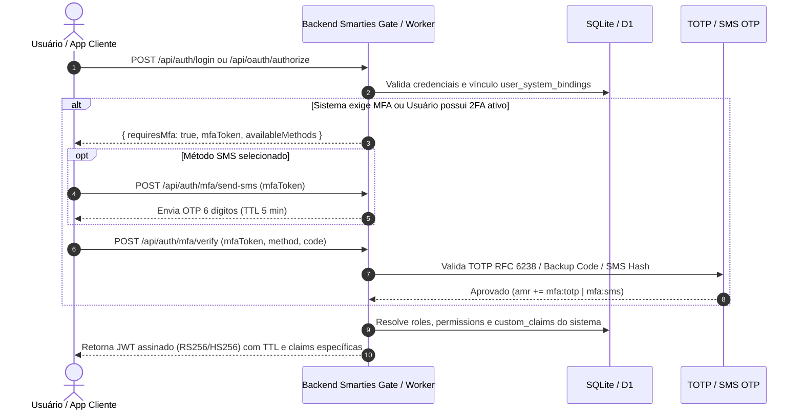
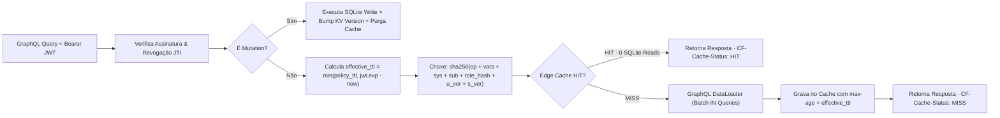
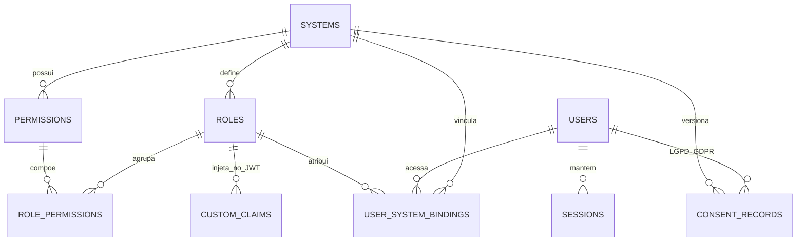

# Smarties Gate — Plataforma de Identidade, OAuth 2.0, RBAC e Governança na Borda

Sistema completo de **Identity and Access Management (IAM)** construído com **React** + **Node.js**, otimizado para **alta taxa de leitura e baixa taxa de gravação** sobre **SQLite (WAL) / Cloudflare D1**, com API **GraphQL** centralizada, **cache distribuído na borda** sensível à expiração de tokens JWT e versões de permissão, **autenticação de dois fatores (TOTP + SMS)**, federação com **provedores externos (IdPs)** e conformidade **LGPD / GDPR**.

---

## Arquitetura do Sistema (Visão Obsidian / Mermaid)

```mermaid
flowchart TB
    subgraph Client["Frontend React (Console Administrativo & Portal do Usuário)"]
        UI_AUTH["Login · 2FA Gate · Sandbox OAuth 2.0"]
        UI_ADMIN["Painel Admin (100% GraphQL CRUD)"]
        UI_PROFILE["Perfil Central (TOTP QR, SMS, Sessões, LGPD)"]
        UI_GQL["GraphQL Explorer & Telemetria Tempo Real"]
    end

    subgraph Edge["Backend Node.js & Adaptador Cloudflare Worker"]
        CACHE["Edge Cache Engine<br/>TTL = min(policy_ttl, jwt_exp - now)"]
        KV["KV Version Store<br/>u_ver:{userId} · s_ver:{systemId}"]
        AUTH["OAuth 2.0 / OIDC · JWT (RS256/HS256) · TOTP/SMS"]
        GQL["GraphQL Engine + DataLoader (Zero N+1)"]
        SSE["SSE Telemetry Hub + PII Masking (LGPD/GDPR)"]
    end

    subgraph Data["Persistência SQLite WAL / Cloudflare D1"]
        DB_READ["Índices Compostos de Cobertura<br/>(users, systems, bindings, roles, claims)"]
        DB_WRITE["Batched Async Writer<br/>(audit_logs em lote)"]
    end

    UI_AUTH --> AUTH
    UI_ADMIN -->|POST /graphql + Bearer JWT| CACHE
    UI_PROFILE -->|POST /graphql + Bearer JWT| CACHE
    UI_GQL -->|POST /graphql| CACHE
    UI_GQL <-->|GET /api/telemetry/stream| SSE

    CACHE -->|Cache HIT| UI_ADMIN
    CACHE -->|Cache MISS + KV Check| GQL
    KV -.->|Invalidação em Mutations| CACHE
    GQL -->|1 Query IN (...) por nível| DB_READ
    AUTH --> DB_READ
    SSE --> DB_WRITE
```

---

## Fluxo de Autenticação JWT / OAuth 2.0 + 2FA Pós-Login



---

## Estratégia de Cache Distribuído na Borda & Prevenção de N+1



---

## Modelo de Dados SQLite / Cloudflare D1



---

## Principais Capacidades Implementadas

- **Sistemas OAuth 2.0 Multi-Tenant**: Criação, edição, exclusão e rotação de `client_secret`, configuração individual de TTL do JWT, algoritmo (`RS256` com `/.well-known/jwks.json` ou `HS256`), política de 2FA obrigatório, política de cache na borda e provedores externos permitidos.
- **RBAC e Claims Personalizadas no Banco**: Permissões atômicas, funções por sistema e claims tipadas (`string`, `number`, `boolean`, `json`) agrupadas dinamicamente no payload do token JWT.
- **GraphQL Otimizado para Leitura**: Todas as operações do painel administrativo trafegam por `POST /graphql` com `DataLoader` (zero N+1), índices compostos de cobertura e headers de diagnóstico (`CF-Cache-Status`, `X-Cache-TTL-Remaining`, `X-SQLite-Queries-Count`, `X-Query-Duration-Ms`).
- **2FA Completo (TOTP + SMS + Backup Codes)**: QR Code SVG RFC 6238, códigos de backup descartáveis com hash SHA-256 e OTP por SMS, exigidos após autenticação inicial por senha/JWT ou OAuth 2.0 conforme política do sistema.
- **Pacote Pronto Cloudflare Workers + D1 + KV**: Exportação direta de `wrangler.toml`, `schema.d1.sql` e `src/worker.ts` pela interface ou via download `.zip`.
- **Conformidade LGPD & GDPR**: Registro de consentimento versionado por sistema, portabilidade (exportação JSON), anonimização irreversível preservando integridade de auditoria e mascaramento de PII nos logs estruturados.

---

## Histórico de Versões Incrementais

### v0.1.0 — Núcleo Backend Node.js, SQLite WAL, GraphQL Otimizado e Exportação Cloudflare D1
- Implementação da camada SQLite em modo `WAL` (`synchronous=NORMAL`, `mmap_size=256MB`, `cache_size=64MB`) com índices compostos de cobertura e escritor assíncrono em lote para `audit_logs`.
- Criação do motor `EdgeCache` com versionamento KV (`u_ver` / `s_ver`) e cálculo estrito de `effective_ttl = min(policy_ttl, jwt.exp - now)`.
- Implementação da API `/graphql` com `DataLoader` em escopo de requisição, CRUD completo de sistemas, usuários, roles, permissões e claims, além de mutações de autoatendimento 2FA e LGPD.
- Criação dos endpoints OAuth 2.0 / OIDC (`/api/oauth/authorize`, `/api/oauth/token`, `/api/oauth/userinfo`, `/.well-known/jwks.json`), fluxo 2FA pós-login (`/api/auth/mfa/verify`) e gerador do pacote Cloudflare Workers + D1.

### v0.2.0 — Console Administrativo React, Fluxo 2FA Interativo, Sandbox OAuth e Portal LGPD/GDPR
- Construção da interface escura de alta precisão (`#090D16` / `#111827` / `#F6821F`) com tipografia tabular (`Plus Jakarta Sans`, `DM Sans`, `JetBrains Mono`).
- Comunicação 100% via GraphQL para todo o CRUD administrativo (Sistemas OAuth 2.0, Usuários, Vínculos Multi-Sistema, Roles, Permissões, Claims e IdPs Externos) com barra de diagnóstico ao vivo (`CF-Cache-Status`, duração e número de consultas SQLite).
- Integração completa de 2FA (TOTP com QR Code SVG + códigos de backup e verificação por SMS OTP) no portal centralizado do usuário e no gate pós-login JWT/OAuth 2.0.
- Adição de relatório de atividades em tempo real via SSE + inspetor JSON estruturado, Explorador GraphQL interativo, download `.zip` do pacote Cloudflare Workers/D1 e painel de conformidade LGPD/GDPR (consentimentos, portabilidade JSON e anonimização).

### v1.0.0 — Verificação de Build, Tipagem TypeScript e Testes de Integração na Borda
- Validação de compilação (`vite build`) e verificação estrita de tipos (`tsc --noEmit`) sem erros.
- Verificação em execução dos endpoints `/api/health`, `/.well-known/jwks.json`, `/api/auth/login`, desafio 2FA (`/api/auth/mfa/send-sms` e `/api/auth/mfa/verify`), `/graphql` (`MISS` com 3 queries em lote via DataLoader -> `HIT` com 0 leituras SQLite e TTL limitado ao `exp` do JWT) e geração do pacote Cloudflare D1/Worker.

### v1.1.0 — Consolidação da Identidade Oficial "Smarties Gate" e Alinhamento dos Artefatos
- Padronização oficial da marca **Smarties Gate** na interface React, título HTML, emissor TOTP/JWT, pacote exportável Cloudflare Workers/D1 e documentação principal (`README.md` e plano de implementação com diagramas Mermaid compatíveis com Obsidian).

### v1.2.0 — Telas de Configuração 100% em Popups Modais
- Conversão de todas as telas de configuração anteriormente renderizadas inline para modais popup dedicados (`fixed inset-0 z-50`), mantendo as visões principais focadas em inspeção e leitura:
  - **Provedores Externos (IdPs)**: formulário de edição de provedor (Google, GitHub, OIDC genérico, Entra ID/SAML) exibido em popup modal.
  - **RBAC, Permissões e Claims**: criação de roles, criação de permissões atômicas e editor de permissões + claims personalizadas convertidos em modais popup, deixando a tela principal em modo catálogo + pré-visualização ao vivo do payload JWT.
  - **Perfil Centralizado & 2FA**: edição de perfil, alteração de senha, configuração de App Autenticador TOTP (QR Code + códigos de backup), configuração de SMS OTP e método 2FA preferencial migrados para modais popup.
  - **Sistemas OAuth 2.0**: exibição única de `client_secret` rotacionado exibida em modal popup dedicado.

### v1.3.0 — AuditLogManager, Estatísticas-Chave e Alerta de Expiração de Sessão
- Criação do componente **`AuditLogManager`** na aba de Visão Geral com tabela pesquisável e filtrável por sistema, status (`success`, `denied`, `error`) e categoria de ação via GraphQL + stream SSE, com inspeção detalhada do evento em popup modal (padrão *master/details* em popup).
- Adição do widget **Estatísticas-Chave (Key Statistics)** no topo de `OverviewTelemetry` exibindo contagens ao vivo de **Usuários Ativos**, **Tokens JWT Válidos** e **Alertas de Segurança Recentes** via consultas GraphQL existentes.
- Implementação do hook **`useSessionExpiration`** que calcula o tempo restante do token JWT e exibe um modal discreto e não intrusivo 5 minutos antes da expiração da sessão.
- Padronização do rótulo **"Criar Sistema"** no gerenciador de sistemas.

### v1.4.0 — Gráfico D3 de Tendência (24h) e Rótulos Concisos de Navegação
- Adição de gráfico de linha interativo com **D3.js** (`d3.scaleTime`, `d3.scaleLinear`, `d3.line`, `d3.area` e tooltip tabular) no `OverviewTelemetry` exibindo a tendência horária de usuários ativos, sessões ativas e eventos nas últimas 24 horas com diagnósticos GraphQL (`CF-Cache-Status`, duração e leituras SQLite).
- Simplificação dos itens do menu lateral para **Visão Geral**, **Sistemas**, **Usuários**, **Permissões**, **Provedores**, **Infraestrutura**, **Conformidade** e **Perfil**.

### v1.5.0 — Distribuição de Códigos HTTP (2xx, 4xx, 5xx) com Recharts e Títulos Refinados
- Adição do widget **Códigos HTTP por Sistema (Últimas 24h)** em `OverviewTelemetry` utilizando **Recharts** (`ResponsiveContainer`, `BarChart` empilhado) para visualizar respostas `2xx`, `4xx` e `5xx` entre todos os sistemas monitorados.
- Refinamento dos títulos das seções e rótulos de ação (**Salvar**, **Atualizar**, **Aplicar**).

### v1.6.0 — Lista de Alertas Recentes em Tempo Real (SSE + Polling)
- Adição da lista **Alertas Recentes** na aba **Visão Geral** monitorando em tempo real (via stream SSE `/api/telemetry/stream` combinado com polling GraphQL a cada 10 segundos) tentativas de acesso não autorizadas e falhas de 2FA, notificando o administrador instantaneamente e oferecendo inspeção detalhada em popup modal.


